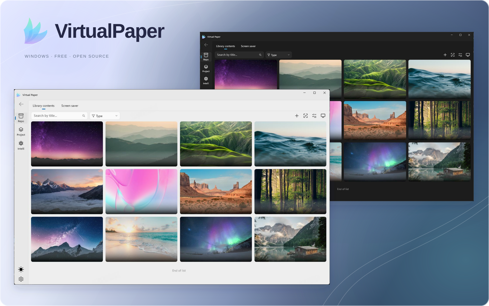
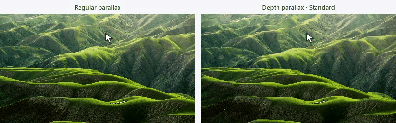
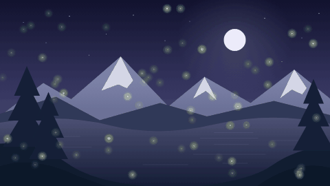
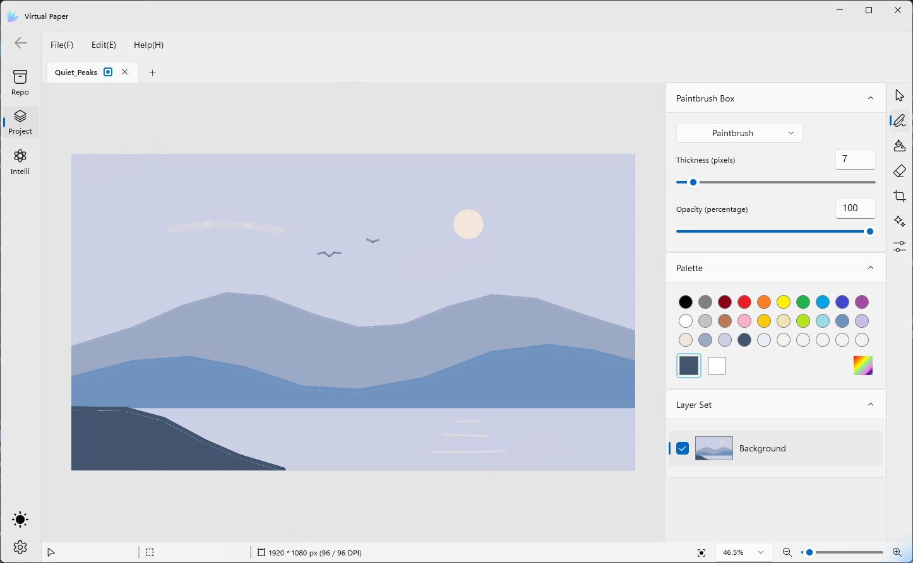
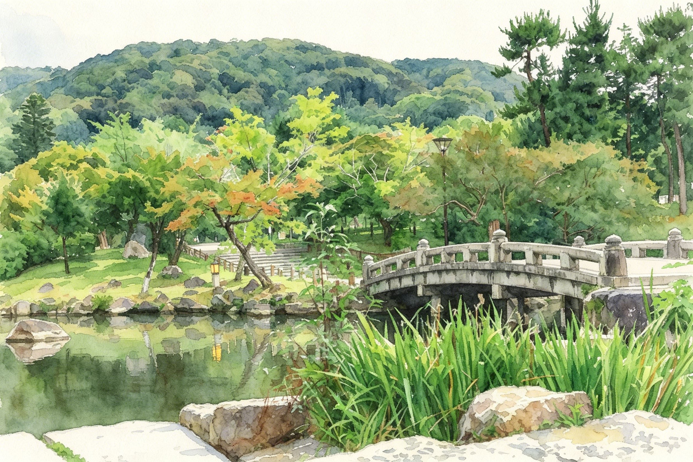
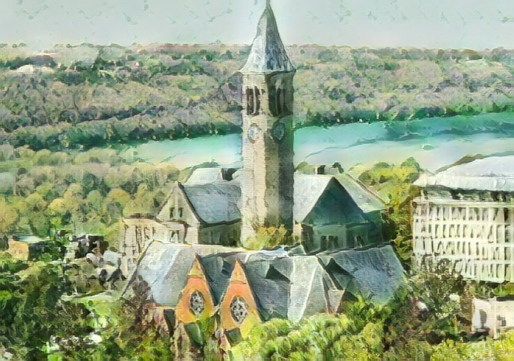
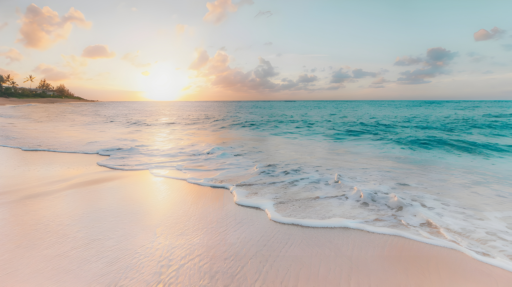
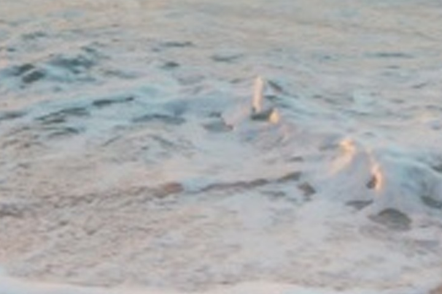
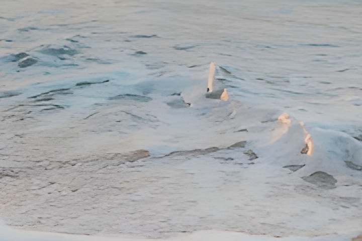

  

  <strong>VirtualPaper is a free, open-source wallpaper application for Windows.</strong> 
  Supports images, videos, animated images, and interactive Web wallpapers. 
  Includes atmosphere effects, 3D parallax, and built-in image editing.

  
  
  
  

  <a href="#features">Features</a> ·
  <a href="#download">Download</a> ·
  <a href="https://github.com/PaperHammer/VirtualPaper/wiki">Documentation</a> ·
  <a href="#support">Support</a>

## Features

### Live wallpapers

Use your own images, GIFs, videos, and Web wallpapers. Keep them together in your library, preview a wallpaper, and apply it to your desktop.

<table>
  <tr>
    <td width="50%" valign="top">
      <h3>🖼️ Images, videos, and more</h3>
      Choose a still image, play an animated wallpaper, or use an interactive Web wallpaper.
    </td>
    <td width="50%" valign="top">
      <h3>🌌 3D wallpapers</h3>
      Give a picture a sense of depth. Let the view follow your mouse or move slowly on its own, and adjust how much it moves.
    </td>
  </tr>
  <tr>
    <td width="50%" valign="top">
      <h3>🖥️ Multiple displays</h3>
      Use a different wallpaper on each display, show the same one on every display, or stretch one wallpaper across them all.
    </td>
    <td width="50%" valign="top">
      <h3>✨ Fit your screen</h3>
      Preview how a picture fills your display. Keep the whole image or crop to fill, and optionally enhance small images before applying them.
    </td>
  </tr>
</table>

### Supported formats

| Content | Formats |
| --- | --- |
| Still images | `.jpg`, `.jpeg`, `.bmp`, `.png`, `.svg`, `.webp` |
| Animated images | `.gif`, `.apng` |
| Video | `.mp4`, `.webm` |
| Web wallpaper packages | `.zip`, `.rar`, `.7z` containing a supported Web wallpaper project |
| Editable projects | `.vpd` for images; `.vpw` for Web projects |

Import wallpaper packages through the library. Open editable `.vpd` image projects and `.vpw` Web projects in the creation workspace.

### Parallax effects

Choose **regular parallax** to tilt the whole picture with your mouse, or **depth parallax** to move foreground and background by different amounts. Both views below use the same image and mouse movement; depth parallax uses the Standard preset.

Depth is estimated locally. Depth wallpapers also support slow automatic movement.

### Atmosphere effects

Add **stardust, snow, fireflies, meteors, rain, petals, or bokeh** to your wallpaper. Choose a style and adjust the intensity. The effects work with images, videos, 3D wallpapers, and Web wallpapers.

<table>
  <tr>
    <td width="50%" align="center">
       
      <h3>Snow</h3>
    </td>
    <td width="50%" align="center">
       
      <h3>Fireflies</h3>
    </td>
  </tr>
  <tr>
    <td width="50%" align="center">
       
      <h3>Meteors</h3>
    </td>
    <td width="50%" align="center">
       
      <h3>Petals</h3>
    </td>
  </tr>
</table>

### Screen saver

Keep your wallpaper on screen when you step away. Use your primary display's wallpaper as a screen saver, choose when it starts, and exclude apps that should keep it from appearing.

### Playback controls

- Choose whether wallpapers keep playing or pause when a fullscreen or focused app is running.
- Set separate playback rules for battery power, power saving, and Remote Desktop.
- Adjust wallpaper settings and effects from the library.

### Create and customize

- **Edit pictures.** Work with layers, brushes, selections, and image effects.
- **Make Web wallpapers.** Edit your project and see the result in a live preview.
- **Improve image quality.** Enlarge small images, restore details, or try a different look with reference-image style transfer.
- **Match your desktop.** Choose a light or dark interface and set a library image as your Windows lock screen background.

Save your work as an editable project. Export images as PNG, BMP, JPEG, or JPEG XR, and Web wallpapers as packages for your library.

### Image enhancement

AI image tools process pictures locally on your PC. Results and processing time depend on the image and your hardware.

**Style transfer**

<table>
  <tr><th width="33%">Original</th><th width="33%">Style reference</th><th width="33%">Result</th></tr>
  <tr>
    <td align="center"></td>
    <td align="center"></td>
    <td align="center"></td>
  </tr>
</table>

**Super resolution**

[960 × 540 input](resources/readme/upscale-input-960.jpg) → [3840 × 2160 result](resources/readme/upscale-result-4k.jpg). The input was prepared by downsampling a photograph.

<table>
  <tr><th width="50%">Bicubic 4×</th><th width="50%">Super resolution 4×</th></tr>
  <tr>
    <td align="center"></td>
    <td align="center"></td>
  </tr>
</table>

The detail crops show the same region at the same display size, without additional sharpening.

## Download

  

**Windows 10 version 2004 (build 19041) or later · Windows 11 · x64**

1. Download the installer above, install, and open VirtualPaper.
2. Add an image, video, animated image, or Web wallpaper to your library.
3. Preview it, apply it to your desktop, and adjust its effects.

See the [user guide](https://github.com/PaperHammer/VirtualPaper/wiki) for more help getting started.

The installer checks for the **.NET 8 Desktop Runtime** and can download it when needed. The **Microsoft Edge WebView2 Runtime** is also required.

> [!NOTE]
> See the [release notes](https://github.com/PaperHammer/VirtualPaper/releases) for the features available in each version.

## Support

Found a problem or have an idea for VirtualPaper? Let us know.

[Report a bug](https://github.com/PaperHammer/VirtualPaper/issues/new?template=bug_report.yml) · [Suggest a feature](https://github.com/PaperHammer/VirtualPaper/issues/new?template=feature_request.yml) · [Improve a translation](https://github.com/PaperHammer/VirtualPaper/issues/new?template=translation_issue.yml)

For bug reports, include your VirtualPaper version, Windows version, and the steps to reproduce the problem. Screenshots and relevant logs help us investigate.

You can also help by improving translations, contributing fixes, or sharing VirtualPaper with others.

### Contribute

See the [developer documentation](doc/README.md) for source setup and builds, and the [testing guide](test/README.md) for running tests. Some detailed developer guides are in Chinese.

For complete local acceptance, run `pwsh -NoProfile -File test/Run-Tests.ps1` from elevated PowerShell 7.2+ on a clean Windows test installation. See the testing guide for required tools, models and the install/UI/uninstall stages.

AI contributors can start with [AGENTS.md](AGENTS.md) and the [repository testing skill](.agents/skills/virtualpaper-testing/SKILL.md). CI and release behavior is documented in the [workflow guide](.github/workflows/README.md).

Open pull requests against `dev`. Please discuss larger changes in an issue first.

## Made possible by open source

With thanks to [Lively Wallpaper](https://github.com/lively-community/lively), [XamlNexus](https://github.com/PaperHammer/XamlNexus), [WinUI 3](https://github.com/microsoft/microsoft-ui-xaml), and [Monaco Editor](https://github.com/microsoft/monaco-editor).

VirtualPaper is free and open source under the [GNU General Public License v3.0](LICENSE). Third-party components and models retain their respective licenses.
